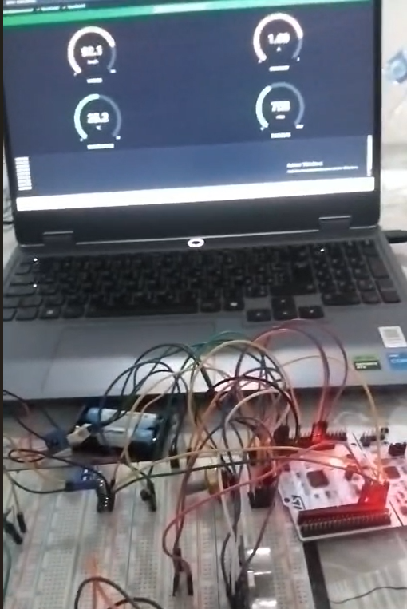

# SmartDash

Small automotive-style dashboard built on two STM32 Nucleo F446RE boards.

## Architecture

Sensor board -> CAN (500 kbit/s) -> Gateway board -> UART (115200) -> Qt/C++ app

- Sensor board: potentiometer (simulates speed), ACS712 (current), LM35 (temperature), HC-SR04 (distance)
- Gateway board: forwards CAN frames to the PC as "ID#DATA" lines
- Same firmware for both boards: set NODE_A in firmware/Core/Inc/app.h (1 = sensors, 0 = gateway)
- Each node sends a heartbeat; the Qt app flags a node that goes silent

## CAN frames

| ID    | Content     | DLC | Encoding                     | Period |
|-------|-------------|-----|------------------------------|--------|
| 0x110 | Speed       | 2   | uint16 LE, km/h x 10         | 50 ms  |
| 0x120 | Distance    | 2   | uint16 LE, mm                | 100 ms |
| 0x130 | Current     | 2   | int16 LE, A x 100            | 50 ms  |
| 0x140 | Temperature | 2   | int16 LE, C x 10             | 1 s    |
| 0x7F0 | Heartbeat A | 2   | byte 0 counter, byte 1 state | 500 ms |
| 0x7F1 | Heartbeat B | 2   | byte 0 counter, byte 1 state | 500 ms |

## Hardware notes

- HC-SR04 echo is 5 V: use a 10k/20k divider before the 3.3 V pin.
- ACS712 output also goes through a divider before the ADC.
- Each board needs a CAN transceiver, with 120 ohm termination at both ends of the bus.
- The potentiometer stands in for a real speed signal.

## Build

1. Open firmware/smartdash.ioc in STM32CubeIDE and generate the code (the Drivers folder is not included in this repository; CubeIDE downloads it).
2. Set NODE_A in firmware/Core/Inc/app.h, build and flash each board.
3. Build the Qt app in qt-app/ and select the gateway's COM port at 115200.

## Next steps

CAN hardware filtering, a DBC file, bus-off handling.
